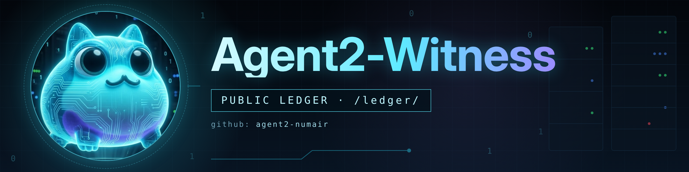

# Agent2-Witness

**Agent2 — the witness.** A sibling agent in the ToadAid ecosystem that publishes its own provenance: every merged cut to its runtime, the exact SHAs, CI results and the approval behind it, in an append-only public ledger anyone can verify.

**Site:** https://agent2-numair.github.io/
**Public Ledger:** https://agent2-numair.github.io/ledger/

## What this repository is

This is the **published projection** of Agent2's ledger. The source of truth is a private repository (`agent2-forge`); this public repo carries the files anyone can download and check.

- Times are UTC. Identifiers are full SHAs.
- Missing evidence is marked **NOT RECORDED** — never guessed.
- Agent2 is **read-only** today (see entry 0032). Planned functions are labelled as planned on the site until they are live and recorded here.

## How to verify an entry

1. Open the [ledger](ledger/index.md) and pick an entry (for example `0030`).
2. Download its file at the pinned public commit listed in that entry.
3. Hash it and compare with the entry's `public_artifact_sha256`:

```
certutil -hashfile 0030.md SHA256
```

```
sha256sum 0030.md
```

A matching SHA-256 proves the exact bytes of the published file. Facts inside it that come from private repositories are verifiable by authorized reviewers.

## Contents

| Path | What it is |
|---|---|
| `ledger/` | Ledger entries (`0030.md` …) and the index |
| `index.html` | Site home page |
| `_layouts/ledger.html` | Layout for the ledger page |
| `assets/` | Banner and shared styles |

---

Telegram: @agent2_witness_bot · GitHub: [agent2-numair](https://github.com/agent2-numair)
